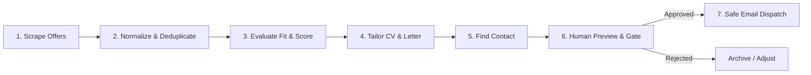
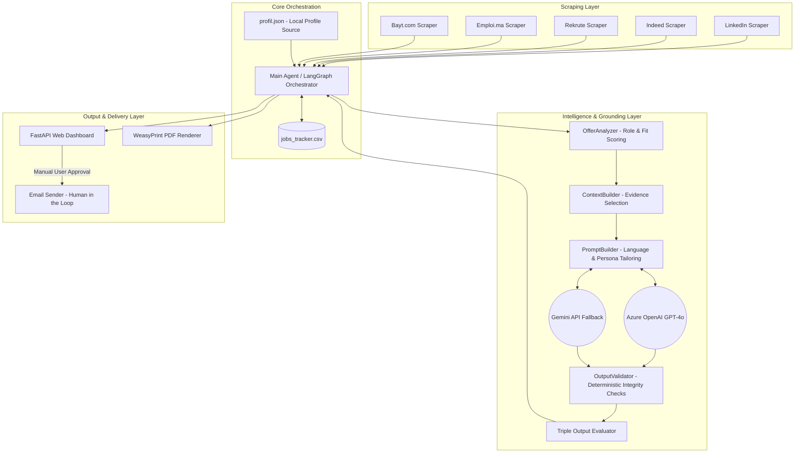

# 🚀 Intelligent Job Application Agent

> **End-to-End AI Automation Pipeline for Job Scraping, Semantic Profile Matching, Evidence-Grounded Document Tailoring, and Safe Human-in-the-Loop Outreach.**

---

## 📑 Table of Contents
1. [Project Overview](#-project-overview)
2. [Key Features](#-key-features)
3. [End-to-End Workflow](#-end-to-end-workflow)
4. [System Architecture](#-system-architecture)
5. [Core Technical Components](#-core-technical-components)
6. [Project Structure](#-project-structure)
7. [Installation & Setup](#-installation--setup)
8. [Configuration (`profil.json`)](#-configuration-profiljson)
9. [Public Repository Safety](#-public-repository-safety)
10. [Roadmap](#-roadmap)

---

## 💡 Project Overview

**Intelligent Job Application Agent** is an end-to-end multi-agent automation system built in Python that streamlines and secures the job discovery and application process.

Rather than being a simple prompt wrapper, it operates as a structured engineering pipeline that:
- **Scrapes and normalizes** job offers from multiple recruitment platforms.
- **Filters and deduplicates** listings to prevent redundant or low-quality processing.
- **Evaluates candidate-offer compatibility** using hybrid deterministic scoring and semantic embeddings.
- **Generates tailored CVs and cover letters** strictly grounded in attested candidate achievements (zero hallucinations).
- **Finds recruiter and hiring manager contacts** for targeted outreach.
- **Provides an interactive dashboard preview** with triple output quality evaluation.
- **Enforces a strict Human-in-the-Loop safety gate** requiring explicit confirmation before any email is dispatched.

---

## 🌟 Key Features

| Module | Capability & Description |
|---|---|
| **Multi-Source Scraping** | Automated extraction from LinkedIn, Indeed, Rekrute, Emploi.ma, and Bayt.com. |
| **Deduplication & Filtering** | URL and normalized metadata hashing to discard duplicates, expired ads, and off-target listings. |
| **Hybrid Match Scoring** | Deterministic keyword weights + role detection + LLM / embedding-based semantic similarity. |
| **A/B/C/D Strategy Matrix** | Classifies every offer into an actionable tier (A: Direct, B: Tailored, C: Opportunistic, D: Light). |
| **CVTailor v6 Engine** | Generates tailored Markdown/PDF CVs & cover letters adapting to role family and offer language (EN/FR). |
| **Evidence Guard & Anti-Hallucination** | Verifies all cited technical competencies against `profil.json` before LLM generation. |
| **Triple Output Scoring** | Evaluates generated documents across **Personalization (45%)**, **Factuality (35%)**, and **RH Readability (20%)**. |
| **FastAPI Web Dashboard** | Real-time web UI (FastAPI + Tailwind CSS) for reviewing applications, scores, and downloads. |
| **Safe Email Dispatch** | Idempotent, concurrency-locked outreach workflow with mandatory human approval. |

---

## 🔄 End-to-End Workflow



### 1. Collect Job Offers
Scrapes job portals on a regular schedule, extracting structured metadata: job title, company, location, URL, description text, and source platform.

### 2. Normalize & Deduplicate
Filters out generic sales or non-technical roles, malformed descriptions, and applies title/URL deduplication so identical postings across different sources are processed only once.

### 3. Evaluate Fit Against Profile
Matches offer requirements against the candidate master profile (`profil.json`). Calculates skill overlap, seniority alignment, and semantic relevance.

### 4. Personalize CV & Cover Letter
Dynamically generates tailored Markdown documents. Structures experience bullets using the **STAR methodology** (Context → Action → Result → Tech Proof) and aligns technical categories with the target role.

### 5. Find Contact Information
Identifies and resolves relevant recruiter emails or hiring manager contacts for direct application outreach.

### 6. Human Preview & Confirmation Gate
Renders generated documents and match reports in the dashboard. No email can be sent automatically—explicit human validation is mandatory.

---

## 🏗️ System Architecture



---

## 🔬 Core Technical Components

### 1. Hybrid Scoring & Match Engine
- **Deterministic Lexicons**: Identifies the dominant role (AI Engineer, Backend, Full-Stack, Data Engineer, QA) and evaluates tech stack overlap against verified profiles.
- **Semantic Embeddings**: Vector similarity (`gemini-embedding-001` or Azure OpenAI) captures synonyms and conceptual alignment (e.g., *ML pipelines* ↔ *Scikit-learn / MLflow*).
- **Seniority Analysis**: Detects seniority discrepancies and adjusts title recommendations to keep applications credible and grounded.

### 2. Evidence Guard & Anti-Hallucination
- **Profile Truth Corpus**: Technical skills, identity details, education and availability not proven in `profil.json` are not invented by the generator.
- **Deterministic Output Validator**: Automatically scans generated outputs for forbidden phrases, accidental third-person phrasing, or unproven claims.
- **Self-Repair Loops**: Automatically triggers targeted revision calls if validation criteria fail.

### 3. Concurrency & State Safety
- **Atomic State Transitions**: Status transitions (`pending` → `approved` → `sent`) use concurrency locks to prevent race conditions and duplicate email dispatches.
- **Scraping Health Monitoring**: Tracks failure rates, empty description counts, and schema shifts across target platforms.

---

## 📂 Project Structure

```text
/
├── app.py                    # FastAPI Backend & Web Dashboard
├── index.html                # Tailwind CSS Dashboard Frontend
├── agent/main_agent.py       # Pipeline Orchestrator (LangGraph)
├── profil.example.json       # Safe example profile for public use
├── profil.json               # Local candidate profile (not committed)
├── core/
│   ├── cv_tailor.py          # CVTailor v6 Pipeline Orchestrator
│   ├── offer_analyzer.py     # Deterministic & Semantic Match Scoring
│   ├── context_builder.py    # Experience/Project Selector & Evidence Formatter
│   ├── prompt_builder.py     # Dynamic Prompt Construction (EN/FR, Persona, STAR)
│   ├── output_validator.py   # Deterministic Validation & Self-Repair
│   ├── lexicons.py           # Role Lexicons, Canonical Tech Vocabularies
│   └── personas.py           # Recruiter Persona System Prompts
├── matching/
│   ├── semantic_matcher.py   # Vector Similarity & Embeddings
│   └── offer_scoring.py      # Multi-criteria Match Logic
├── integrations/
│   ├── llm_manager.py        # LLM Routing & Fallback Management
│   ├── email_finder.py       # Recruiter Contact Scraping
│   ├── email_sender.py       # Safe Email Outreach Service
│   └── sheets_manager.py     # Optional Google Sheets Sync
├── jobs_tracker.csv          # Local state store, created at runtime
├── output/                   # Generated CVs and letters, ignored by Git
└── scrapers/                 # Specialized Scrapers (LinkedIn, Indeed, Rekrute, etc.)
```

The following files are intentionally local and are not included in the public repository: `.env`, `profil.json`, `credentials.json`, `jobs_tracker.csv`, logs, generated documents and OAuth tokens.

---

## 🚀 Installation & Setup

### 1. Prerequisites
- Python 3.10+
- An Azure OpenAI Deployment (GPT-4o) or a Google Gemini API Key

### 2. Installation
```bash
# Clone the repository
git clone <repository-url>
cd scraper

# Install Python dependencies
pip install -r requirements.txt
```

### 3. Local Configuration
Create a local `.env` file from `.env.example`:
```env
# Azure OpenAI (Primary LLM)
AZURE_OPENAI_ENDPOINT=https://your-resource.openai.azure.com/
AZURE_OPENAI_API_KEY=your_azure_api_key
AZURE_OPENAI_DEPLOYMENT=gpt-4o
AZURE_OPENAI_API_VERSION=2024-02-01

# Google Gemini (Fallback & Embeddings)
GEMINI_API_KEY=your_gemini_api_key

# Optional NVIDIA fallback
NVIDIA_API_KEY=your_nvidia_api_key
NVIDIA_MODEL=meta/llama-3.3-70b-instruct

# Provider selection and email safety
LLM_PROVIDER=auto
JOB_AGENT_SEND_EMAILS=false
GMAIL_CREDENTIALS_FILE=gmail_credentials.json
```

Never commit `.env`, `credentials.json`, `profil.json`, `jobs_tracker.csv`, or generated output. Copy `profil.example.json` to `profil.json` and replace its placeholder identity with your local profile. For Google Sheets access, copy `credentials.example.json` to `credentials.json` and provide OAuth credentials locally. Keep `JOB_AGENT_SEND_EMAILS=false` until an email has been reviewed manually.

The repository history previously contained local credentials, API keys, and personal data. Before making a fork or repository public, revoke and recreate every exposed API key and Google OAuth client secret, then remove those paths from Git history with a history-rewrite tool such as `git filter-repo`. Coordinate that rewrite with anyone who has cloned the repository.

### 4. Running the Project
```bash
# Launch FastAPI Web Dashboard
python app.py
# → Access via http://localhost:8000

# Or execute the complete automated pipeline
python -m agent.main_agent
```

### 5. Tests

Tests that load the candidate profile require a local `profil.json`. Create it from `profil.example.json` before running the suite:

```bash
python -m pytest
```

Pour contrôler le seuil de couverture du cœur déterministe (helpers, validation et scoring) :

```bash
python -m pytest --cov=core.helpers --cov=core.output_validator --cov=matching.offer_scoring --cov-report=term-missing --cov-fail-under=90
```

Les scrapers, fournisseurs LLM et services d'e-mail restent testés séparément avec des mocks afin de ne pas dépendre d'un réseau ou de secrets locaux.

---

## 🛠️ Configuration (`profil.json`)

`profil.json` acts as the single source of truth for the candidate profile:

| Block | Role & Content |
|---|---|
| `identity` | Contact details, location, GitHub, LinkedIn, portfolio links. |
| `career_strategy` | Target roles, positioning angles by role family, summary. |
| `technical_ecosystem` | Attested skills grouped by area (AI/LLM, Backend, Frontend, Data, DevOps). |
| `professional_experience` | Work experiences with STAR accomplishments, context, and proven tech stack. |
| `featured_projects` | Projects with business problems, architecture highlights, and tech proofs. |
| `education_and_certs` | Academic degrees and verified certifications. |
| `optimization` | Spoken languages, ATS aliases, and differentiators. |

The profile is the only source of truth for personal details. The application does not add a student status, degree, availability date, employer, metric or technology that is absent from the local profile.

---

## 🔐 Public Repository Safety

- Use `.env.example`, `profil.example.json` and `credentials.example.json` as templates only.
- Do not commit personal profiles, OAuth files, API keys, job trackers, logs or generated CVs.
- Revoke any credential that was ever exposed before publishing or forking the repository.
- Keep email sending disabled until the dashboard review and human confirmation are complete.
- See [SECURITY.md](SECURITY.md) for private vulnerability reporting guidance.

---

